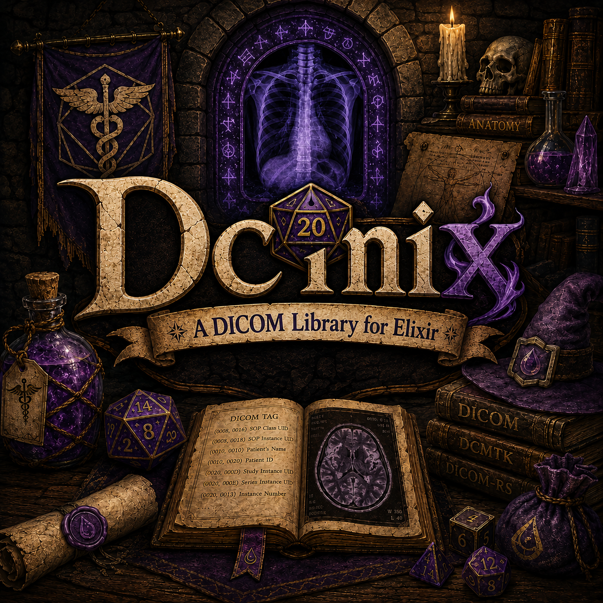

# Dcmix

A DICOM library for Elixir - read, write, and manipulate DICOM files.

Dcmix (pronounced "DCM-icks") is a pure Elixir implementation for working with DICOM medical imaging files, inspired by [dcmtk](https://dicom.offis.de/dcmtk.php.en) and [dicom-rs](https://github.com/Enet4/dicom-rs).

> **⚠️ Experimental Status**
>
> This project is in an **experimental stage** and is not yet recommended for production use.
> A significant portion of this codebase was generated with AI assistance and has not been
> fully vetted for correctness, security, or compliance with the DICOM standard. Use at your
> own risk and please report any issues you encounter.



## Features

- Read and parse DICOM Part 10 files
- Write DICOM files with proper file meta information
- Multiple transfer syntax support (Implicit VR LE, Explicit VR LE/BE)
- Export to JSON, XML, and image formats (PNG, PPM, PGM)
- Import from JSON, XML, and image files
- Human-readable dump output (dcmdump style)
- DICOM networking: C-ECHO SCU (verify a connection), C-FIND SCU (query remote PACS servers), C-GET SCU (retrieve from them) and C-MOVE SCU (have them send to a Storage SCP), and a listener that accepts associations, answers C-ECHO and stores instances sent with C-STORE (SCP)
- Write a DICOMDIR for a file set (dcmmkdir style)
- Private tag support
- Mix tasks for CLI usage

## Installation

Add `dcmix` to your list of dependencies in `mix.exs`:

```elixir
def deps do
  [
    {:dcmix, github: "avandra/dcmix"}
  ]
end
```

## Quick Start

### Reading DICOM Files

```elixir
# Read a DICOM file
{:ok, dataset} = Dcmix.read_file("patient.dcm")

# Get element values
patient_name = Dcmix.get_string(dataset, "PatientName")
rows = Dcmix.get(dataset, {0x0028, 0x0010})

# Dump contents
IO.puts(Dcmix.dump(dataset))
```

### Writing DICOM Files

```elixir
dataset = Dcmix.new()
|> Dcmix.put({0x0010, 0x0010}, :PN, "Doe^John")
|> Dcmix.put({0x0010, 0x0020}, :LO, "12345")
|> Dcmix.put({0x0008, 0x0060}, :CS, "CT")

:ok = Dcmix.write_file(dataset, "output.dcm")
```

### Export Formats

```elixir
# Export to JSON (DICOM JSON Model)
{:ok, json} = Dcmix.to_json(dataset, pretty: true)

# Export to XML (Native DICOM Model)
{:ok, xml} = Dcmix.to_xml(dataset)

# Export pixel data to image
:ok = Dcmix.to_image(dataset, "output.png")
```

### Querying a PACS Server

```elixir
# Build a query
query =
  Dcmix.DataSet.new()
  |> Dcmix.DataSet.put_element({0x0010, 0x0010}, :PN, "")
  |> Dcmix.DataSet.put_element({0x0008, 0x0020}, :DA, "20250101-20251231")

# Query a remote DICOM server
{:ok, datasets} = Dcmix.find("localhost:4242", query,
  calling_ae_title: "MY_SCU",
  called_ae_title: "PACS_AE"
)

Enum.each(datasets, fn ds ->
  IO.puts(Dcmix.DataSet.get_string(ds, {0x0010, 0x0010}))
end)
```

### Verifying a Connection

```elixir
# C-ECHO: :ok when the server accepts the association and answers with success
:ok = Dcmix.Network.echo("localhost:4242", calling_ae_title: "MY_SCU", called_ae_title: "PACS_AE")
```

### Listening for Associations

`Dcmix.Network.Listener` accepts associations on a port, as an SCP, and
answers C-ECHO. Given a handler (`Dcmix.Network.SCP.Handler`), it is also a
Storage SCP: each instance sent with C-STORE is written to a file in the
storage directory as it arrives, then handed to the handler, whose status is
sent back. Start it in your own supervision tree; it needs the optional
`:thousand_island` dependency, so add `{:thousand_island, "~> 1.6"}` to your
deps.

```elixir
defmodule MyApp.StoreHandler do
  @behaviour Dcmix.Network.SCP.Handler

  @impl true
  def handle_store(instance, state) do
    IO.puts("Stored #{instance.sop_instance_uid} at #{instance.path}")
    {:reply, 0x0000, state}
  end
end

children = [
  {Dcmix.Network.Listener,
   port: 11112,
   ae_title: "MY_SCP",
   max_associations: 10,
   handler: MyApp.StoreHandler,
   storage_directory: "incoming"}
]

Supervisor.start_link(children, strategy: :one_for_one)
```

### Retrieving from a PACS Server

```elixir
identifier =
  Dcmix.DataSet.new()
  |> Dcmix.DataSet.put_element({0x0008, 0x0052}, :CS, "STUDY")
  |> Dcmix.DataSet.put_element({0x0020, 0x000D}, :UI, "1.2.3.4")

# C-GET: the server sends each instance back on the same association
{:ok, %Dcmix.Network.CGet.Result{status: 0x0000, files: files}} =
  Dcmix.Network.get("localhost:4242", identifier,
    calling_ae_title: "MY_SCU",
    called_ae_title: "PACS_AE",
    output_directory: "retrieved"
  )
```

### Moving Instances to a Storage SCP

```elixir
# C-MOVE: the server sends the instance to MY_SCP over its own association,
# e.g. to a Dcmix.Network.Listener with a handler
identifier =
  Dcmix.DataSet.new()
  |> Dcmix.DataSet.put_element({0x0008, 0x0052}, :CS, "IMAGE")
  |> Dcmix.DataSet.put_element({0x0020, 0x000D}, :UI, "1.2.3")
  |> Dcmix.DataSet.put_element({0x0020, 0x000E}, :UI, "1.2.3.4")
  |> Dcmix.DataSet.put_element({0x0008, 0x0018}, :UI, "1.2.3.4.5")

{:ok, %Dcmix.Network.CMove.Result{status: 0x0000, completed: 1}} =
  Dcmix.Network.move("localhost:4242", identifier,
    calling_ae_title: "MY_SCU",
    called_ae_title: "PACS_AE",
    destination_ae_title: "MY_SCP",
    on_response: fn response ->
      IO.puts("#{response.remaining || 0} remaining")
      :cont
    end
  )
```

### CLI Tools

```bash
mix dcmix.dump patient.dcm
mix dcmix.to_json --pretty patient.dcm output.json
mix dcmix.to_xml patient.dcm output.xml
mix dcmix.to_image --window auto patient.dcm output.png
mix dcmix.mkdir --fileset-id STUDY_01 media
```

Network tools named after dcmtk's take its long option names, and its
short flags (`-aet`, `-aec`, `-aem`, `-k`, `-od`, `-to`, `-td`, ...) work
too, so a dcmtk command line runs with the tool name swapped:

```bash
mix dcmix.echoscu -aet DCMIX -aec ORTHANC localhost 4242
mix dcmix.findscu -S -k QueryRetrieveLevel=STUDY -k PatientID=12345 -k StudyInstanceUID= -aec ORTHANC localhost 4242
mix dcmix.getscu -k QueryRetrieveLevel=STUDY -k StudyInstanceUID=1.2.3 -aec ORTHANC -od retrieved localhost 4242
mix dcmix.movescu -k QueryRetrieveLevel=STUDY -k StudyInstanceUID=1.2.3 -aec ORTHANC -aem MY_SCP localhost 4242
mix dcmix.storescp -aet MY_SCP -od incoming 11112   # needs :thousand_island
```

## Documentation

- [Detailed Usage Guide](docs/USAGE.md) - Pixel data, private tags, import operations, DICOMDIR
- [Transfer Syntax Support](docs/TRANSFER_SYNTAXES.md) - Supported transfer syntaxes
- [Roadmap](docs/ROADMAP.md) - Current and planned features

## Development

```bash
mix deps.get          # Install dependencies
mix test              # Run tests
mix test --cover      # Run tests with coverage
mix credo --strict    # Static analysis
mix sobelow           # Security analysis
```

## Contributing

See [CONTRIBUTING.md](CONTRIBUTING.md) for guidelines.

## License

MIT License - see [LICENSE](LICENSE) for details.

## Acknowledgments

- Inspired by [dcmtk](https://dicom.offis.de/dcmtk.php.en) and [dicom-rs](https://github.com/Enet4/dicom-rs)
- DICOM standard from [NEMA](https://www.dicomstandard.org/)
